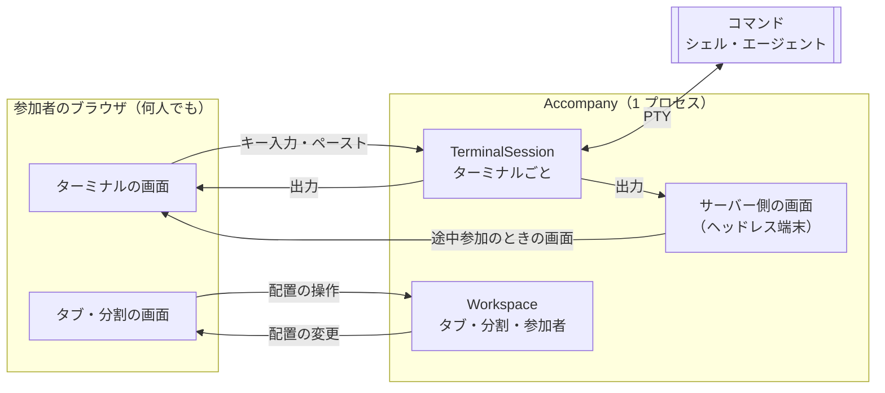

# Accompany（同行）

AI コーディングエージェントを交えたリモート・ペアプログラミングのための、エージェント・ネイティブな Web UI サーバー。

## エレベーターピッチ（v2）

- **ターゲット**: AI コーディングエージェントを交えたリモート・ペアプログラミングを行いたい開発チーム向けの
- **課題/ニーズ**: コーディングエージェントを前提とした共有環境が整備されておらず、既存のターミナル共有や Live Share 等では「TUI の描画崩れ」や「同期のズレ」といった辛さが生じる現状を解決する
- **プロダクト名**: Accompany（同行） は、
- **カテゴリー**: エージェント・ネイティブなリモートペアプロ用 Web UI サーバーです。
- **解決策/コアバリュー**: Hono/Bun をベースに、エージェントが動くターミナルプロセスをバックグラウンドでホストし、その入出力を Web UI としてブラウザに配信します。これにより、描画崩れを物理的に排除し、複数人が同じ URL にアクセスするだけで安定したエージェントとの協働環境を即座に構築します。
- **代替手段**: TUI 環境の画面サイズ制約に悩まされる Tmux/ttyd や、特定のエディタに依存する拡張機能とは異なり、
- **差別化要因**: インフラやエディタに依存せず、純粋な Web アプリケーションとして動くため、ローカルからオンプレ K8s の使い捨て Pod まであらゆる場所で動き、ブラウザ一つでシームレスな共有体験を提供する点が最大の特長です。

## 構成

| ディレクトリ | 内容 |
|---|---|
| `app/` | アプリケーション本体。必要に応じてサービスごとにサブディレクトリを切る |
| `e2e/` | E2E テスト |
| `environments/` | 実行環境の定義（ローカル、K8s など） |
| `docs/` | 開発プロセス・ストーリー管理のルール |

## 仕組み

Accompany は、ターミナルごとにコマンドをサーバー上で 1 つ動かし、参加者全員のブラウザはそのプロセスをのぞく「窓」になる、という作りになっている。画面の共有ではなく、プロセスの共有である。

### プロセスの管理

- ターミナル 1 つにつき、サーバー上でコマンドを 1 つ、PTY（疑似端末）付きで起動する。最初のターミナルは起動時に指定したコマンド、分割や新しいタブで増やしたターミナルはシェル（`$SHELL`）を動かす
- コマンドは、最初のブラウザがそのターミナルにつながったときに起動する。起動直後の出力も取りこぼさない
- ブラウザを閉じても、コマンドは止まらない。参加者が全員いなくなっても動き続け、次につながった人がそのまま続きを見る
- コマンドが終了すると（シェルの `exit` など）、そのターミナルは画面から閉じる。逆に、ターミナルやタブを閉じる操作をすると、そのコマンドを止める。どちらも、最後に残った 1 つのターミナルは閉じない
- Accompany を止めるとき（Ctrl+C など）は、画面の配置とスクロールバックを保存してから、すべてのコマンドを止める

### 入力と出力の同期

- 参加者のキー入力やペースト（ドロップしたファイルのパスの貼り付けも含む）は、ブラウザからサーバーへ送り、届いた順に PTY に書き込む。誰の入力も同じ 1 つのプロセスに入るので、全員が同じ端末を同時に操作できる（入力の順番待ちや、操作する人の切り替えはない）
- コマンドの出力は、サーバーから全員のブラウザへ同じバイト列を同じ順番で配る。各ブラウザはそれを自分の端末で描くので、全員の画面が同じになる
- サーバーも、出力を自分の中の端末（ヘッドレス端末。画面には出さない）に書き込み、いまの画面の状態を持ち続ける。途中から参加した人には、まずこの画面の状態を送り、その続きの出力を送る。そのため、全画面の TUI（エージェントなど）の途中から入っても、画面が崩れない
- 端末の大きさ（列数・行数）は 1 つのプロセスにつき 1 つしか持てないので、そのターミナルにつながっている参加者のうち、一番大きい表示領域に合わせる。各ブラウザは、表示領域（フル HD までとみなす）と自分のフォントの大きさから入る列数・行数を数えてサーバーに送り、サーバーはその最大に合わせる。参加者の出入り、ウィンドウやフォントの大きさの変更のたびに決め直し、全員に伝える。表示領域の小さい人は、スクロールか縮小で全体を見る

### タブ・分割・参加者の同期

- タブの並びと表示中のタブ、分割の配置と割合、よく使うコマンドの一覧は、サーバーが 1 つだけ持つ。ブラウザは操作（分割・閉じる・タブの切り替えなど）をサーバーに送るだけで、自分では変えない。サーバーが変更を反映して全員に配り、全員が同じ配置を描く。そのため、誰かがタブを切り替えると、全員の表示がそのタブに切り替わる
- 各参加者がどのターミナルにフォーカスしているかも、サーバーを通して全員に配る。各ターミナルのバーに、そこにフォーカスしている参加者の名前をその人の色で出す。自分がフォーカスしているターミナルは、枠を自分の色で強調する
- 配色とフォントの大きさは、参加者ごとにブラウザに保存し、見た目は自分のブラウザだけに効く。ただし、フォントを小さくすると表示領域に入る列数・行数が増えるので、端末の大きさが変わることがある

### エージェントの状態の判定

- エージェントが「作業中」か「入力待ち」かは、PTY の入出力の流れ方から判定する。参加者が入力したあとに出始めた出力が 1 秒以上続けば作業中、出力が 2 秒途切れたら入力待ちとみなす。入力の表示（エコー）や、端末が自動で返す応答は数えない。エージェントごとの作りには依存しない
- 作業中から入力待ちに変わると、そのターミナルを見ていない参加者（ページが隠れている、ほかのタブを表示している、ほかのターミナルにフォーカスしている）のうち、通知を許可した人のブラウザがデスクトップ通知を出す

### 再起動したときの復元

- 画面の配置と表示中のタブ、ターミナルごとのサーバー側の画面（スクロールバック）、よく使うコマンドを、起動したディレクトリごとに 1 つのファイルへ保存する。変化があってから 1 秒ほど置いてまとめて書く
- 次に同じディレクトリで起動すると、配置とスクロールバックを戻す。プロセスそのものは戻せないので、戻したターミナルではシェルを新しく起動し、戻したスクロールバックの下に区切りを出す。起動時のコマンドを動かしていたターミナルだけは、今回の起動時のコマンドを動かす
- 戻さずに新しく始めるときは、`--fresh` を付けて起動する

### 接続の制限

- 認証がまだないため、`127.0.0.1` だけで待ち受ける。ほかのマシンからは、SSH のポート転送などでつなぐ
- ターミナルの操作（WebSocket）とファイルのアップロードは、Accompany 自身の画面からの接続だけを受け付ける（Host が loopback で、Origin が同じもの）。ほかのサイトのページから端末を操作されないようにするため
