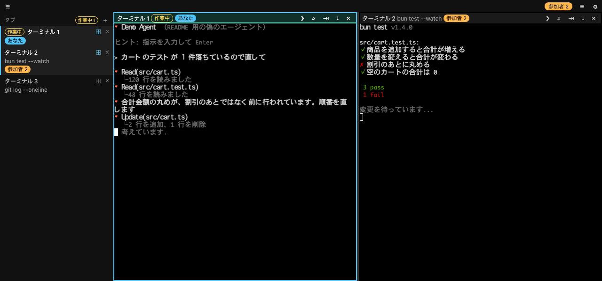
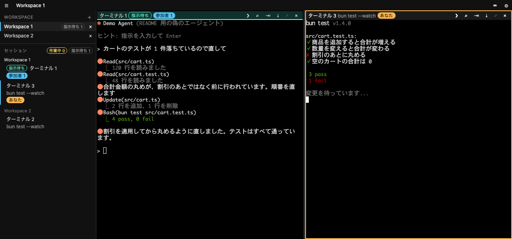
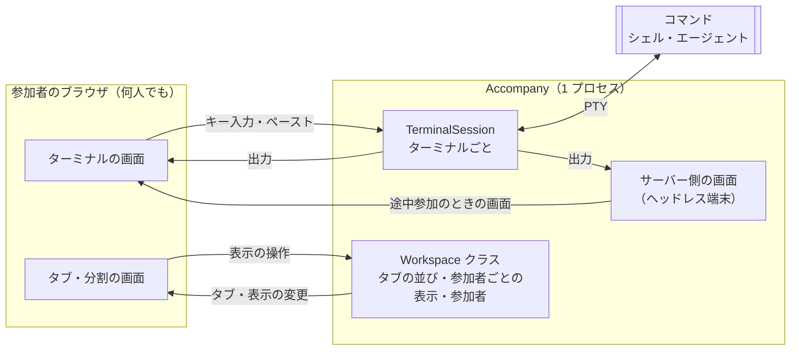

# Accompany（同行）

[](https://www.npmjs.com/package/accompany)
[](https://github.com/itsuki-yamada/accompany/actions/workflows/release.yml?query=branch%3Amain)
[](LICENSE)

AI コーディングエージェントのターミナルをブラウザで共有する Web UI サーバー。VS Code Live Share の「サーバーの共有（Share server）」と組み合わせて、エージェントを交えたリモート・ペアプログラミングを楽にするエスケープハッチ（逃げ道）。

Live Share の共有ターミナルで Claude Code などの TUI のエージェントを動かすと、描画が崩れたり、ホストとゲストの画面がずれたりする。そんなときは、ホストのマシンで Accompany を起動し、そのポートを Live Share の「サーバーの共有」でゲストに渡す。ゲストは自分のブラウザで `http://localhost:<ポート>` を開くだけで、ホストと同じエージェントのターミナルを見て、同じように操作できる。

- エージェントはホストのマシン上で 1 つだけ動き、全員のブラウザはそれをのぞく窓になる。画面の共有ではなく、プロセスの共有なので、描画が崩れず、途中から参加しても同じ画面になる
- 全員が同じターミナルに同時に入力できる。誰がどのターミナルを見ているか、エージェントが作業中か指示待ちかが、全員の画面に出る
- Live Share がなくても、SSH のポート転送などで同じように使える

<details>
<summary>エレベーターピッチ（v2）</summary>

- **ターゲット**: AI コーディングエージェントを交えたリモート・ペアプログラミングを行いたい開発チーム向けの
- **課題/ニーズ**: コーディングエージェントを前提とした共有環境が整備されておらず、既存のターミナル共有や Live Share 等では「TUI の描画崩れ」や「同期のズレ」といった辛さが生じる現状を解決する
- **プロダクト名**: Accompany（同行） は、
- **カテゴリー**: エージェント・ネイティブなリモートペアプロ用 Web UI サーバーです。
- **解決策/コアバリュー**: Hono/Bun をベースに、エージェントが動くターミナルプロセスをバックグラウンドでホストし、その入出力を Web UI としてブラウザに配信します。これにより、描画崩れを物理的に排除し、複数人が同じ URL にアクセスするだけで安定したエージェントとの協働環境を即座に構築します。
- **代替手段**: TUI 環境の画面サイズ制約に悩まされる Tmux/ttyd や、特定のエディタに依存する拡張機能とは異なり、
- **差別化要因**: インフラやエディタに依存せず、純粋な Web アプリケーションとして動くため、ローカルからオンプレ K8s の使い捨て Pod まであらゆる場所で動き、ブラウザ一つでシームレスな共有体験を提供する点が最大の特長です。

</details>

## 使用イメージ

ホストの画面。左のサイドメニューに、タブ（ターミナル 1 つが 1 つのタブ）の一覧が状態とともに出る。ホストはエージェントのタブとテストの結果のタブを選んで、左右に並べている。左のエージェントは作業中。バーのバッジは、そのターミナルにフォーカスしている人（自分は「あなた」、ゲストは「参加者 2」）。



同じ Accompany を、ゲストのブラウザで見た画面。Live Share のサーバーの共有と同じように、別のポートで受けて Accompany へ TCP のまま転送し、そのポートで開いた。どのタブを表示するかは参加者ごとで、ゲストはエージェントのタブだけを選んで画面いっぱいに出している。エージェントが作業を終え、指示待ちに変わっている。出力はホストと同じで、ペアプロモードにすれば、ホストと同じタブの選び方・並べ方で見られる。



（スクリーンショットのエージェントとテストの表示は、撮影用の偽のコマンドのもの）

## 使い方

[Release](https://github.com/itsuki-yamada/accompany/releases) に、正式版（Latest）と、main の最新のコミットから作った先行版（edge）を置いている。

入れ方は、Bun が Accompany の JS を動かすもの（Homebrew、npx、tarball）を勧める。署名のない実行ファイルは、EDR などのセキュリティの製品に疑われ、止められることがあるため（docs/adr/191-run-on-bun.md）。Bun を入れたくないときは、実行ファイルも使える。

### Homebrew で入れる（macOS・Linux）

このリポジトリを tap して入れる。正式版の tarball と、依存の `bun`（homebrew-core）が入り、Accompany の JS をその `bun` で動かす。Intel の Mac では、homebrew-core に `bun` の bottle がないので、これまでどおり実行ファイルが入る。

```sh
brew tap itsuki-yamada/accompany https://github.com/itsuki-yamada/accompany
brew install itsuki-yamada/accompany/accompany
accompany
```

- 最初の `brew install` は、`itsuki-yamada/accompany/accompany` のように tap の名前を付けて入れる。Homebrew は、名前を付けて指定した formula だけを信頼して読み込む（`brew install accompany` だけでは、信頼していない tap として断られる）
- 新しい版に上げるときは `brew upgrade accompany`。正式版を出してから formula が新しい版になるまで、少し遅れることがある
- `ps` などでは、プロセスの名前は `accompany` ではなく `bun`（`bun …/libexec/dist/cli.js`）と出る
- Bun の tap（`oven-sh/bun`）の `bun` を入れている人は、それが依存の `bun` として使われる。homebrew-core の `bun` と同じ名前なので、`brew install` や `brew upgrade` が止まったときは、`brew uninstall oven-sh/bun/bun` で外してから入れ直す（homebrew-core の `bun` でも、`bun` は今までどおり使える）
- やめるときは `brew uninstall accompany` と `brew untap itsuki-yamada/accompany`（`bun` が要らなければ `brew autoremove`）

表示された URL（`http://127.0.0.1:3000`）をブラウザで開く。ポート（既定 3000、`--port` で指定したもの）がほかのプロセスに使われていたら、空いているポートまで 1 つずつ上げて（10 個まで）待ち受け、そのポートの URL を表示する。起動のしかたは次のとおり（npx、tarball、実行ファイルで起動するときも同じ）。

```sh
accompany                        # 最初のターミナルで $SHELL を動かす
accompany -- claude              # 最初のターミナルで動かすコマンドを指定する
accompany --port 4000            # 待ち受けるポートを変える
accompany --fresh                # 前回の画面を戻さずに始める
accompany --min-window 960x1080  # 端末の大きさの下限を、ウィンドウの大きさ（ピクセル）で指定する（保存はしない）
accompany --version              # 版を表示する（-v でもよい）
accompany --help                 # 使い方を表示する（-h でもよい）
```

### npx で起動する（Node.js 18 以上）

正式版を npm にも公開している。macOS（Apple Silicon・Intel）と Linux（x64・arm64、glibc）で動く。

```sh
npx accompany                 # 最初のターミナルで $SHELL を動かす
npx accompany -- claude       # 最初のターミナルで動かすコマンドを指定する
npx accompany --port 4000     # 待ち受けるポートを変える
```

- PATH に Bun（1.4.0 以上）があれば、パッケージに入っている Accompany の JS を Bun で動かす。なければ、自分の OS と CPU の実行ファイルを起動する（Bun は入れなくてもよい）
- Bun があっても実行ファイルで動かしたいときは、`ACCOMPANY_USE_BINARY=1 npx accompany` のように起動する（`1` のときだけ効く）
- PATH の中の相対のディレクトリ（`.` など）にある `bun` は使わない
- 毎回 npx で取らずに入れておくときは `npm i -g accompany` で入れ、`accompany` で起動する
- 起動のしかた（`--fresh`、`--min-window` など）と、Ctrl+C で保存してから止まることは、上の Homebrew と同じ
- 入るのは、主パッケージ `accompany`（起動役と JS）と、自分の OS と CPU の実行ファイルのパッケージ（`@itsuki-yamada/accompany-darwin-arm64` など）だけ。Bun がないときは、optionalDependencies を入れない設定（`--omit=optional` など）では起動できない

### tarball から起動する（Bun 1.4.0 以上が要る）

Bun が入っていれば、tarball（`accompany-<バージョン>.tgz`）からも起動できる。tarball は絶対パスで指定する（相対パスでは bunx が失敗する）。

```sh
bunx --package "$PWD/accompany-0.6.0.tgz" accompany
```

Bun 1.3 までは、画面の JS と CSS が読み込まれず、画面が空になる（docs/adr/78-binaries.md）。古い Bun で起動すると、必要な版を表示して終了するので、`bun upgrade` で上げるか、実行ファイルを使う。

### 実行ファイルで起動する（Bun は要らない）

Bun を入れたくないときは、Bun を中に持った実行ファイルを使える。自分の OS と CPU のものを 1 つ選ぶ。`uname -sm` の結果で選べる。

| マシン | `uname -sm` | ファイル |
|---|---|---|
| macOS（Apple Silicon: M1〜M4 など） | `Darwin arm64` | `accompany-<バージョン>-darwin-arm64` |
| macOS（Intel） | `Darwin x86_64` | `accompany-<バージョン>-darwin-x64` |
| Linux（x64） | `Linux x86_64` | `accompany-<バージョン>-linux-x64` |
| Linux（arm64） | `Linux aarch64` | `accompany-<バージョン>-linux-arm64` |

- edge のファイル名には、バージョンのあとにコミット ID が入る（`accompany-0.6.0-fefd04d-darwin-arm64` など）
- Linux 向けは glibc のディストリビューション（Ubuntu、Debian、Fedora など）で動く。Alpine などの musl では動かない
- 署名のない実行ファイルなので、EDR などのセキュリティの製品に止められることがある（ブラウザでつないだ直後に `Killed` で終わる、など）。そのときは、上の Bun で動かす入れ方を使う

```sh
# 正式版の、Apple Silicon の Mac 向けをダウンロードする（edge は `gh release download edge ...`）
gh release download --repo itsuki-yamada/accompany --pattern 'accompany-*-darwin-arm64'
chmod +x accompany-*-darwin-arm64
./accompany-0.6.0-darwin-arm64
./accompany-0.6.0-darwin-arm64 -- claude       # 起動のしかたは、上の Homebrew と同じ
```

ダウンロードしたファイルが、書き換えられていないことと、このリポジトリの CI で作られたことは、`SHA256SUMS` と `gh attestation verify` で確かめられる（[SECURITY.md](SECURITY.md#release-のファイルを確かめる)）。

#### macOS で、ダウンロードしたファイルを実行できないとき

実行ファイルは Apple の公証を受けていない。ブラウザでダウンロードすると、ファイルに quarantine の属性が付き、macOS（Gatekeeper）に起動を止められる。「開発元を検証できません」「Apple は … を検証できませんでした」と表示されたり、起動したまま何も表示されなかったりする。

- 実行する前に、属性を外す。`gh release download` や `curl` でダウンロードしたものには、属性は付かない

  ```sh
  xattr -d com.apple.quarantine accompany-0.6.0-darwin-arm64
  ```

- 一度止められたあとは、属性を外しても起動できないことがある。ダウンロードし直し、実行する前に属性を外す。または、「システム設定」→「プライバシーとセキュリティ」に出る「このまま開く」を押す
- `permission denied` と表示されるときは、`chmod +x` で実行できるようにする
- `Killed: 9` と表示されるときは、ファイルが壊れている（既にある実行ファイルに上書きでコピーした、など）。消してからダウンロードし直す

### 直前のコマンドの出力をコピーする（シェルの統合）

ターミナルの右下の「⧉ コピー」を押す（右クリックのメニューの「直前のコマンドの出力をコピー」でもよい）と、直前に実行したコマンドの出力が、押した人のクリップボードに入る。コマンドの区切りはシェルの統合（OSC 133）で見分けるので、`mise activate` と同じように、シェルの設定ファイルに次の 1 行を書いておく（docs/adr/112-copy-last-output.md）。

```sh
# zsh（~/.zshrc）
eval "$(accompany activate zsh)"
# bash 4.4 以上（~/.bashrc）
eval "$(accompany activate bash)"
# fish（~/.config/fish/config.fish）。fish 4.0 以上は書かなくてもよい
accompany activate fish | source
```

- シェルを省く（`accompany activate`）と、`$SHELL` から決める。詳しくは `accompany activate --help`
- プロンプト（PS1 など）は書き換えない。何度読み込んでも 1 回分だけ効く。Accompany の外の端末で読み込んでも害はない
- ほかのシェルの統合（fish 4.0 以上の組み込みのものなど）で OSC 133 の C（出力の始まり）と D（出力の終わり）の印が出ていれば、書かなくても使える
- 全画面のアプリ（vim や Claude Code の全画面の表示など）の中では使えない
- `activate` という名前のコマンドを最初のターミナルで動かすときは、`accompany -- activate` と書く

## Live Share で使う

1. ホストが、自分のマシンで Accompany を起動する（[使い方](#使い方)）。例: `./accompany-0.6.0-darwin-arm64 -- claude`。表示された `http://127.0.0.1:3000` を、ホスト自身のブラウザで開く
2. ホストが VS Code で Live Share のセッションを始め、ゲストを招待する
3. ホストが、Live Share のビュー（アクティビティバーの Live Share、またはエクスプローラーの Live Share）で **Share server**（サーバーの共有）を選び、Accompany のポート（起動したときに表示された URL のポート。既定は `3000`）を入力する。名前は任意（`Accompany` など）
4. ゲストは、Live Share のビューの **Shared Servers** の一覧から Accompany を選ぶ（ブラウザで開く）か、自分のブラウザで `http://localhost:3000` を開く

- ゲストの手元でそのポートが既に使われていると、Live Share は別のポートを割り当てる。そのときは **Shared Servers** の一覧に出るリンクを開く。ポート番号が変わっても、Accompany の制限には弾かれないはず（下記）
- 共有をやめるときは、ホストが **Shared Servers** の一覧で **Unshare server** を選ぶ。Live Share のセッションを終えると、共有も終わる
- ゲストは、ホストのマシンでコマンドを実行できるようになる（Live Share の読み書きできるターミナルの共有と同じ）。信頼できる相手とだけ共有する
- ゲストの画面がつながらないときは、ホスト側で `localhost` が IPv6（`::1`）に解決されている可能性がある。Accompany は `127.0.0.1` だけで待ち受けている
- Live Share の操作は、公式ドキュメントの [Share a server](https://learn.microsoft.com/en-us/visualstudio/liveshare/use/share-server-visual-studio-code#share-a-server) を参照

### Host・Origin の制限で弾かれないはずの理由

Accompany は、ほかのサイトのページから端末を操作されないよう、WebSocket とアップロードを、Host が loopback（`localhost`・`127.0.0.1`・`[::1]`）で、Origin が Host と同じものに限っている（[接続の制限](#接続の制限)）。Live Share のサーバーの共有は、ゲストの手元の localhost のポートを、ホストの Accompany のポートへ TCP のまま転送する。そのため、

- ゲストのブラウザは `http://localhost:<ゲスト側のポート>` を開いているので、Host は `localhost:<ゲスト側のポート>`、Origin は `http://localhost:<ゲスト側のポート>` になる。Host は loopback で、Origin は Host と同じなので、受け付けられるはず
- 制限は Host のホスト名と、Origin が Host と同じかだけを見て、ポート番号そのものは見ない。画面の JS も、開いているページと同じホストとポート（`location.host`）に WebSocket をつなぐ。そのため、ゲスト側でポート番号が変わっても弾かれないはず
- 実際の Live Share ではまだ確かめていない。手元では、別のポートで受けて TCP のまま転送するプロキシ越しに、表示・入力・タブの操作ができることを確かめた

## 仕組み

Accompany は、ターミナルごとにコマンドをサーバー上で 1 つ動かし、参加者全員のブラウザはそのプロセスをのぞく「窓」になる、という作りになっている。画面の共有ではなく、プロセスの共有である。



### プロセスの管理

- ターミナル 1 つにつき、サーバー上でコマンドを 1 つ、PTY（疑似端末）付きで起動する。最初のターミナルは起動時に指定したコマンド、新しいタブや分割で増やしたターミナルはシェル（`$SHELL`）を動かす
- コマンドは、最初のブラウザがそのターミナルにつながったときに起動する。起動直後の出力も取りこぼさない
- ブラウザを閉じても、コマンドは止まらない。参加者が全員いなくなっても動き続け、次につながった人がそのまま続きを見る
- コマンドが終了すると（シェルの `exit` など）、そのタブは閉じる。逆に、タブを閉じる操作をすると、そのコマンドを止める。どちらも、最後に残った 1 つのタブは閉じない
- Accompany を止めるとき（Ctrl+C など）は、タブの並びとスクロールバックを保存してから、すべてのコマンドを止める

### 入力と出力の同期

- 参加者のキー入力やペースト（ドロップしたファイルのパスの貼り付けも含む）は、ブラウザからサーバーへ送り、届いた順に PTY に書き込む。誰の入力も同じ 1 つのプロセスに入るので、全員が同じ端末を同時に操作できる（入力の順番待ちや、操作する人の切り替えはない）
- コマンドの出力は、サーバーから全員のブラウザへ同じバイト列を同じ順番で配る。各ブラウザはそれを自分の端末で描くので、全員の画面が同じになる
- サーバーも、出力を自分の中の端末（ヘッドレス端末。画面には出さない）に書き込み、いまの画面の状態を持ち続ける。途中から参加した人には、まずこの画面の状態を送り、その続きの出力を送る。そのため、全画面の TUI（エージェントなど）の途中から入っても、画面が崩れない
- 端末の大きさ（列数・行数）は 1 つのプロセスにつき 1 つしか持てないので、そのターミナルにつながっている参加者（ページを見ていない人も含む）のうち、一番小さい表示領域に合わせる。各ブラウザは、表示領域（フル HD までとみなす）と自分のフォントの大きさから入る列数・行数を数えてサーバーに送り、サーバーはその最小に合わせる。参加者の出入り、ウィンドウやフォントの大きさの変更のたびに決め直し、全員に伝える
- ただし、極端に狭い人に全員が引きずられないよう、下限を設ける。下限はウィンドウの大きさ（既定はフル HD を縦に 4 つに分けた 1 つ分、480×1080 ピクセル）で持ち、各ブラウザが、そのウィンドウで Accompany を開いたときに入る列数・行数も伝え、サーバーは、一番大きい人の画面に入る範囲で、端末をその大きさまで広げる（1 人のときや、全員が下限より小さい画面のときは、一番大きい人の画面に合わせる）。下限は ⚙（表示の設定）で変えられ、参加者全員に効き、保存して再起動後も残る。下限より表示領域の小さい人は、スクロールか縮小で全体を見る

### タブ・分割・参加者の同期

- ターミナル 1 つが 1 つのタブになる。タブの並びとよく使うコマンドの一覧は、サーバーが 1 つだけ持ち、全員に配る
- どのタブを表示しているか（タブを 1 つ選べばそのターミナルだけを画面いっぱいに、並べて表示のボタン・タブの右クリックのメニュー・ターミナルの端へのドラッグで 3 つまで分割して並べる。分割したタブはタブの並びでも隣り合い、まとまりとして残って、分割のタブを選ぶとそのまま戻る）と、分割の割合は、参加者ごと。サーバーが参加者ごとに持ち、本人にだけ配る。ブラウザは操作（タブを選ぶ・並べる・分割する・閉じるなど）をサーバーに送るだけで、自分では変えない。ほかの参加者がタブを開いたり切り替えたりしても、自分の表示は変わらない
- ペアプロモードの間は、サーバーが相手の表示（タブの選び方と分割）を自分の表示に写し、相手と同じ画面を見る。自分で表示を変えるとペアプロモードをやめ、やめたあとは相手が切り替えても自分の表示は変わらない
- 各参加者がどのターミナルにフォーカスしているかも、サーバーを通して全員に配る。各ターミナルのバーに、そこにフォーカスしている参加者の名前をその人の色で出す。自分がフォーカスしているターミナルは、枠を自分の色で強調する
- サイドメニューには、タブの一覧（タイトル・状態・フォーカスしている参加者）と、状態ごとの件数を出す。サーバーから配られるタブ・タイトル・状態・フォーカス先から、各ブラウザが組み立てる。出す・隠すは参加者ごとにブラウザに保存し、隠している間はツールバーにタブを並べる
- 配色とフォントの大きさは、参加者ごとにブラウザに保存し、見た目は自分のブラウザだけに効く。ただし、フォントを小さくすると表示領域に入る列数・行数が増えるので、端末の大きさが変わることがある

### エージェントの状態の判定

- エージェントが動いているかは、ターミナルの前面のプロセスから見分ける。入出力があってから少し間を置いて `ps` で前面のプロセスグループを調べ、その引数の名前が `claude`・`codex`・`gemini` などなら、エージェントが動いているとみなす。エージェントが動いているターミナルだけに状態を出し、バーの色を変えて目立たせる。シェルやふつうのコマンドには状態を出さず、通知もしない
- エージェントが「作業中」か「指示待ち」かは、PTY の入出力の流れ方から判定する。参加者が入力したあとに出始めた出力が 1 秒以上続けば作業中、出力が 2 秒途切れたら指示待ちとみなす。入力の表示（エコー）や、端末が自動で返す応答は数えない。エージェントが前面になった時点から数え始めるので、シェルから起動したときの起動の描画も数えない。エージェントごとの作りには依存しない
- 作業中から指示待ちに変わると、そのターミナルを見ていない参加者（ページが隠れている、そのタブを表示していない、ほかのターミナルにフォーカスしている）のうち、通知を許可した人のブラウザがデスクトップ通知を出す
- 作業が終わったときに誰も見ていなければ（そのタブを表示していて、そのターミナルにフォーカスしていて、ページが見えている参加者がいない）、「指示待ち」ではなく「未確認」と出す。誰か 1 人がそのターミナルを見ると、全員の表示から「未確認」が消えて「指示待ち」になる。各ブラウザはページが見えているかをサーバーに伝え、サーバーがフォーカス先と合わせて判断する。未確認かどうかは保存しない

### 再起動したときの復元

- タブの並び、ターミナルごとのサーバー側の画面（スクロールバック）、よく使うコマンド、端末の大きさの下限を、起動したディレクトリごとに 1 つのファイルへ保存する。参加者ごとの表示（どのタブをどう並べているか）は保存しない。変化があってから 1 秒ほど置いてまとめて書く
- 次に同じディレクトリで起動すると、タブとスクロールバックを戻す。プロセスそのものは戻せないので、戻したターミナルではシェルを新しく起動し、戻したスクロールバックの下に区切りを出す。起動時のコマンドを動かしていたターミナルだけは、今回の起動時のコマンドを動かす
- 戻さずに新しく始めるときは、`--fresh` を付けて起動する

### 接続の制限

- 認証がまだないため、`127.0.0.1` だけで待ち受ける。ほかのマシンからは、Live Share のサーバーの共有（[Live Share で使う](#live-share-で使う)）や、SSH のポート転送などでつなぐ
- ターミナルの操作（WebSocket）とファイルのアップロードは、Accompany 自身の画面からの接続だけを受け付ける（Host が loopback で、Origin が同じもの）。ほかのサイトのページから端末を操作されないようにするため

## 開発

| ディレクトリ | 内容 |
|---|---|
| `app/` | アプリケーション本体。必要に応じてサービスごとにサブディレクトリを切る |
| `e2e/` | E2E テスト |
| `environments/` | 実行環境の定義（ローカル、K8s など） |
| `docs/` | 開発プロセス・ストーリー管理のルール |

開発の進め方は [docs/development-process.md](docs/development-process.md) を参照。

## ライセンス

[MIT](LICENSE)
